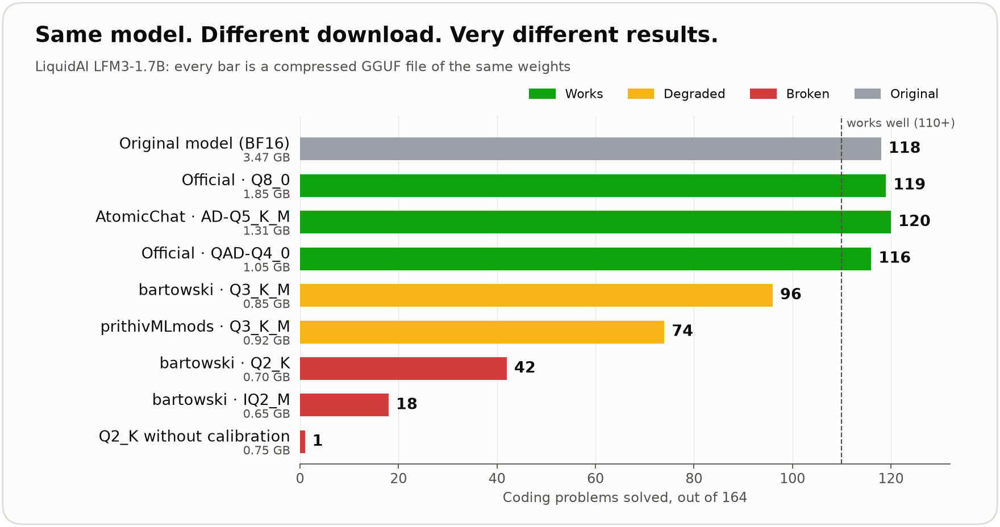
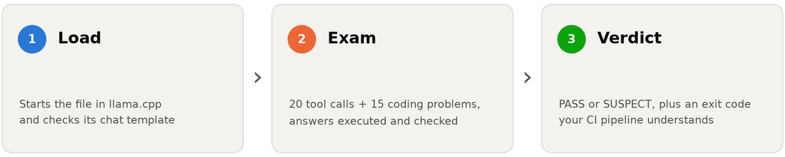
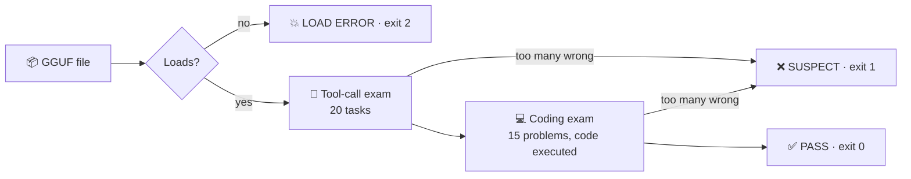
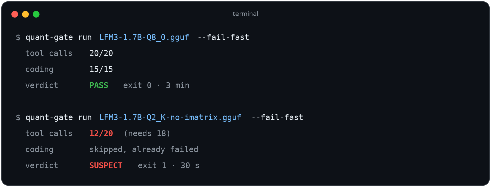
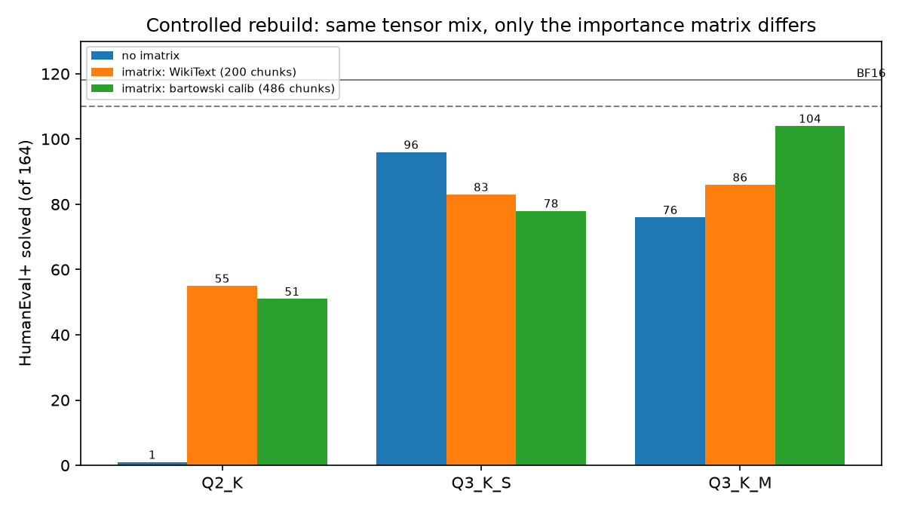
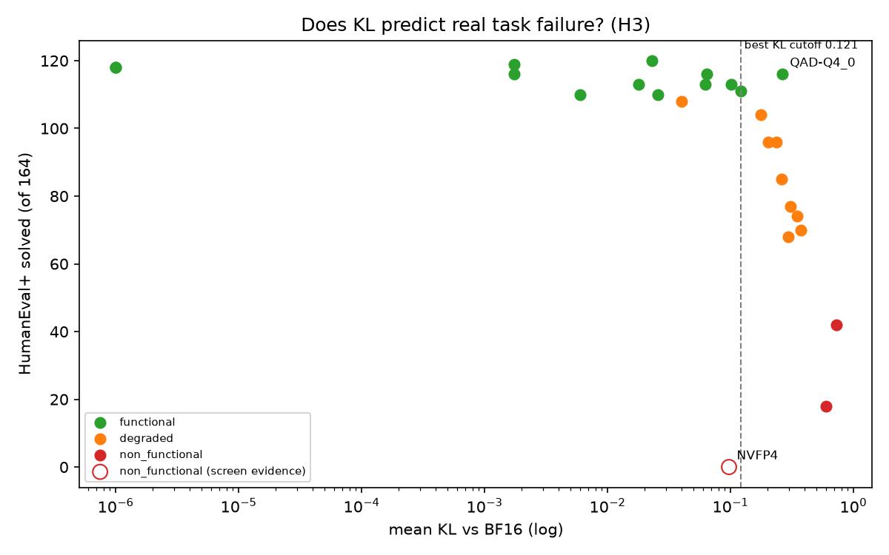

<div align="center">

<p align="center">
  
</p>

### Your compressed AI model loads. But does it still *work*?

**quant-gate tests a GGUF model file in minutes and gives a clear PASS or FAIL, on your laptop or automatically in GitHub Actions.**

<p align="center">
  
  
  
</p>

[Quickstart](#-try-it-in-3-commands) · [How it works](#-how-it-works) · [Results](#-result-what-i-found) · [GitHub Action](#-use-it-in-github-actions) · [FAQ](#-faq)

---

People run AI models on their own machines by downloading **compressed copies** (GGUF files). Compression can quietly ruin a model: the file loads, the chat works, and the answers are wrong. **quant-gate gives the file a short exam and tells you, before your users find out.**

<picture>
  <source media="(prefers-color-scheme: dark)" srcset="assets/hero-dark.png">
  
</picture>

</div>

---

## 😬 Situation: the problem nobody checks

To run AI models on a laptop or phone, people download **compressed copies** of them, usually as `.gguf` files from Hugging Face or Ollama. Compression makes a model small enough to fit, but it also throws information away.

Think of a JPEG photo. Compress it a little and it looks the same. Compress it too much and it still *opens*, but the picture is ruined. With AI models it's worse, because **you can't see the damage**. The file loads, the chat window works, and the answers are quietly wrong.

- One popular model can have **dozens of compressed versions** from different uploaders, often with **identical names**.
- **Nobody tests them** before you download them.
- A recent study found broken files sitting in the official Ollama library ([Broken on Arrival, arXiv:2609.05881](https://arxiv.org/abs/2609.05881)).

<details>
<summary><b>New to this? The 5 terms used on this page, explained in one line each</b></summary>

| Term | Plain meaning |
|---|---|
| **GGUF** | The file format people use to run AI models on their own computer (with llama.cpp, Ollama, LM Studio). |
| **Quantization** | Compressing a model by storing its numbers with fewer bits. Like saving a photo at lower quality. |
| **Q8_0, Q4_K_M, Q2_K…** | Names for compression levels. The number is roughly the bits per value: 8 is almost lossless, 2 is extreme. |
| **imatrix (calibration)** | An extra step that tells the compressor which numbers matter most, so it protects them. |
| **KL divergence** | A common quick check: how differently the compressed model predicts the next word compared with the original. |

</details>

## 🎯 Task: what I set out to do

1. **Build a quality gate**: a test that takes a model file and answers *"does it still work?"* in minutes, with an exit code that can block a bad file automatically.
2. **Use it on a real case**: test **every public compressed version (45 files, 4 uploaders)** of [LiquidAI's LFM3-1.7B](https://huggingface.co/LiquidAI/LFM3-1.7B), a popular small model built for running on devices.
3. **Explain what it finds**: why do files with the *same name* behave differently?

## 🛠️ Action: what I built

## ⚙️ How it works

<picture>
  <source media="(prefers-color-scheme: dark)" srcset="assets/how-dark.png">
  
</picture>



| ⚡ Fast | 🧪 Real tests | 🚦 CI-ready | 🧾 Traceable |
|---|---|---|---|
| ~4 minutes per file. Broken files rejected in **~30 seconds**. | Answers are executed and checked exactly. No AI judging another AI. | Exit codes plus a ready-made GitHub Action. | Every run saves a report with the file's fingerprint and the exact software version used. |

### 🚀 Try it in 3 commands

```bash
# 1. Install (needs llama.cpp built at release b12128, see "Full setup" below)
git clone https://github.com/VatsalRoy/quant-gate.git && cd quant-gate
pip install -e . && export QG_LLAMA_BIN_DIR=/path/to/llama.cpp/build/bin

# 2. Download a model file
hf download LiquidAI/LFM3-1.7B-GGUF LFM3-1.7B-Q8_0.gguf --local-dir models

# 3. Test it
quant-gate run models/LFM3-1.7B-Q8_0.gguf --fail-fast
```

<p align="center"></p>

<details>
<summary><b>Full setup, all options, and exit codes</b></summary>

```bash
git clone https://github.com/ggml-org/llama.cpp.git && cd llama.cpp
git checkout b12128 && cmake -B build -DCMAKE_BUILD_TYPE=Release && cmake --build build -j && cd ..
git clone https://github.com/VatsalRoy/quant-gate.git && cd quant-gate
python -m venv .venv && source .venv/bin/activate && pip install -e .
export QG_LLAMA_BIN_DIR=$PWD/../llama.cpp/build/bin
```

| Option | What it does |
|---|---|
| `--fail-fast` | Stop as soon as the file can no longer pass |
| `--full` | Full exam: 164 coding problems + 60 tool tasks, with a *functional / degraded / non-functional* verdict |
| `--kl-base FILE` | Also report KL divergence vs the original model |
| `--cpu` | Run without a GPU |

| Exit code | Meaning |
|---|---|
| `0` | Pass |
| `1` | Fail (suspect, degraded, non-functional, or packaging problem such as a missing chat template) |
| `2` | The file won't load |
| `3` | The *tester* broke. This says nothing about the file. |

</details>

### 🤖 Use it in GitHub Actions

Add one step, and any pull request that adds a broken model file turns red:

```yaml
- uses: VatsalRoy/quant-gate/action@v1
  with:
    hf-repo: LiquidAI/LFM3-1.7B-GGUF
    hf-file: LFM3-1.7B-Q8_0.gguf
```

**See it live:** [demo run, one file passes ✅, one fails ❌](https://github.com/VatsalRoy/quant-gate/actions/runs/42905797336). The passing check took **7.4 minutes** on GitHub's free (no-GPU) runner. The broken test file is published with a clear warning: [vatsal-roy-29/LFM3-1.7B-Q2_K-no-imatrix-BROKEN](https://huggingface.co/vatsal-roy-29/LFM3-1.7B-Q2_K-no-imatrix-BROKEN).

## 📊 Result: what I found

<table>
<tr>
<td align="center"><h2>45</h2>public files tested</td>
<td align="center"><h2>1 / 164</h2>problems solved by a file that loads with no errors</td>
<td align="center"><h2>1 → 55</h2>problems solved after changing one compression setting</td>
<td align="center"><h2>7×</h2>faster than the full benchmark</td>
</tr>
</table>

### 1. Compress this model below about 1 GB, and it stops being good at coding
The original solves **118** of 164 coding problems. **All 10** fully tested files smaller than 1 GB scored below the "works well" line, and the two smallest solved **18** and **42**.
> **What it means for you:** for this model, "smallest file that fits" is a trap. See the table below for files that actually work.

### 2. Same name, different quality
Two files both called **Q3_K_M** solve **96** and **74** problems. To find out why, I rebuilt the model myself, changing **only one thing**: the calibration step (imatrix).

<p align="center"></p>

- At the most extreme compression, calibration is the difference between **broken (1 solved)** and **usable (51–55)**.
- At moderate compression, **which calibration data you use** matters more than whether you calibrate: one set gave **+28** problems, another made no reliable difference.

> **What it means for you:** the quality of a file depends on *how* it was made, not just its name. Test the file, not the label.

### 3. The usual quick check isn't enough
The standard shortcut (KL divergence, "how much does it drift from the original?") ranks files fairly well. But two of my files had **the same drift score (0.258 vs 0.261)** and solved **86 vs 104** problems. And a specially retrained official file *looked* worse by that score while performing *better*.
> **What it means for you:** measure what users actually need (working answers), not only a proxy.

<details>
<summary>Chart: drift score vs real coding score for every fully tested file</summary>
<p align="center"></p>
Even the best possible drift cutoff, chosen after seeing the answers, lets two degraded files through and blocks a good one.
</details>

### 4. Coding breaks long before tool calling
This model is marketed for "agents" that call tools, so I expected tool calls to fail first. The opposite happened: tool calls stayed at **85% or more** of the original in every public file I fully tested, while coding fell to **15%**.
> **What it means for you:** a tool-calling demo can look fine on a file that's badly damaged.

### 5. Some failures have nothing to do with the model
The official **NVFP4** file needs a recent llama.cpp. On a slightly older version it **loads without any error and outputs only "GGGG…"**. quant-gate caught it. A "does it load?" check would not have. [Details](docs/findings_nvfp4.md)

### 📥 Which LFM3-1.7B file should I download?

Based on the full exam (164 coding problems, 60 tool tasks):

| If you want… | File | Size | Coding score |
|---|---|---|---|
| The **smallest file that works** | `bartowski/LFM3-1.7B-GGUF` · IQ4_XS | 1.00 GB | 111 / 164 ✅ |
| The **best small file** | `LiquidAI/LFM3-1.7B-GGUF` · QAD-Q4_0 | 1.05 GB | 116 / 164 ✅ |
| The **best score under 1.5 GB** | `AtomicChat/LFM3-1.7B-GGUF` · AD-Q5_K_M | 1.31 GB | 120 / 164 ✅ |
| The **safe default** | `LiquidAI/LFM3-1.7B-GGUF` · Q8_0 | 1.85 GB | 119 / 164 ✅ |
| *(reference)* | Original BF16 | 3.47 GB | 118 / 164 |

⚠️ **Avoid for coding:** every file under 1 GB that I fully tested. All 45 files' results are in [results/summary.csv](results/summary.csv).

## ✅ Can you trust the results?

I tested the tester. Every file the quick exam flagged (13), plus 10 random files it passed, were re-run on the **full** exam:

- **It missed 1 of 10** degraded files, and that one scored **108** where the line is **110**.
- **It wrongly flagged 2 of 13** files, each by a **single problem**.
- Every mistake was right at the borderline. Nothing badly broken slipped through.
- The same file gave the same result on a Mac GPU and on GitHub's Linux CPU, and re-running a file reproduced its result exactly.

<details>
<summary>The statistics, for the curious</summary>

- Miss rate 1/10 (95% Wilson interval 1.8%–40%); false-alarm rate 2/13 (4.3%–42%). Ten sampled passes can't rule out a meaningful miss rate.
- Thresholds: the original solves 118/164; it and its near-lossless Q8_0 copy disagree on 5 problems (≈1.4 points of noise), so "works well" = within 5 points (≥ 110).
- The 15 exam problems were chosen from the original model's results only, before any compressed file was tested.
- Controlled rebuild: exact McNemar tests on per-problem results, Bonferroni-corrected across 18 comparisons. Details: [docs/findings_rebuild.md](docs/findings_rebuild.md), [docs/thresholds.md](docs/thresholds.md).
</details>

## 🔍 Built carefully: bugs I caught in my own tool

A testing tool is only useful if it doesn't fool you. Each of these silently produced wrong numbers until I caught it, and each now has a safeguard.

| What I saw | What was really happening | Safeguard now |
|---|---|---|
| A near-perfect file scored **0%** on easy problems | The code runner crashed on macOS before running any test, and logged it as "timeout" | Stops with an error instead of reporting a fake 0% |
| Scores about **16 points too low** | The model sometimes "thinks out loud" even with thinking off, and ran out of room before answering | Hidden reasoning is detected, removed, and counted |
| A correct answer marked wrong | A stray formatting mark after valid JSON | Separate scores for "correct" and "cleanly formatted", decided before testing any file |
| Results labelled with the **wrong software version** | The tool launched an older copy of llama.cpp it found on the system. CI on a clean machine exposed it. | Every report records exactly which program ran. Re-tests on the correct version matched. [Details](docs/environment.md) |

## ❓ FAQ

<details><summary><b>Does this work for models other than LFM3-1.7B?</b></summary>

Yes, but its pass marks are tuned to this model. For another model, run its original and Q8_0 versions on the full exam, then set new pass marks in `quant_gate/thresholds.py`. The steps are in [docs/thresholds.md](docs/thresholds.md).
</details>

<details><summary><b>Do I need a GPU?</b></summary>

No. It runs on CPU (that's how the GitHub Action runs). A GPU just makes it faster.
</details>

<details><summary><b>Why not just measure perplexity or KL divergence?</b></summary>

They're useful dashboards, but this project found files where they point the wrong way (see finding 3). quant-gate reports KL too, but decides on real tasks.
</details>

<details><summary><b>What does "SUSPECT" mean? Is the file definitely broken?</b></summary>

It failed the quick exam. Run `--full` for the definitive answer. In testing, files flagged SUSPECT were degraded or worse 11 times out of 13; the other 2 were borderline.
</details>

<details><summary><b>Are the uploaders doing something wrong?</b></summary>

No. Low-bit files are published as size-vs-quality trade-offs, and uploaders label them as such. The point is that users currently can't see *how much* quality a given file gives up. quant-gate makes that visible.
</details>

## ⚠️ Limitations

- One model studied in depth (LFM3-1.7B); pass marks are model-specific.
- llama.cpp only. Census on Apple M5; CI on Linux CPU.
- Census answers were generated with llama.cpp b11960 (see the version bug above); re-tests on the pinned b12128 matched.
- A 60-task tool exam written for this project; greedy decoding with thinking off.

## 📚 Learn more

[Thresholds and how they were chosen](docs/thresholds.md) · [Controlled rebuild](docs/findings_rebuild.md) · [NVFP4 case](docs/findings_nvfp4.md) · [Environment and versions](docs/environment.md) · [All results](results/summary.csv) · [How to reproduce every number](#-full-reproduction)

<details id="-full-reproduction">
<summary><b>Full reproduction</b></summary>

| Step | Command |
|---|---|
| List all files | `python scripts/inventory.py` |
| Baselines | `python scripts/run_code.py models/LFM3-1.7B-BF16.gguf` · `python scripts/run_tools_screen.py models/LFM3-1.7B-BF16.gguf --full` · `python scripts/compare_baselines.py` |
| Pick exam problems | `python scripts/select_code_screen.py` |
| Drift baseline | `python scripts/make_text_data.py && python scripts/run_kl.py --make-base` |
| Test all 45 files | `python scripts/census.py` |
| Re-check on full exam | `python scripts/confirm.py` |
| Controlled rebuild | `python scripts/rebuild.py && python scripts/run_rebuild.py && python scripts/rebuild_stats.py` |
| Charts | `python scripts/analyze.py && python scripts/make_hero.py` |

</details>


## 📄 Learn more

**[Full research report](paper/report.pdf)**: method, statistics, all 25 fully benchmarked files, threats to validity.
&nbsp;·&nbsp; [Environment and versions](docs/environment.md)

<sub>Inspired by <a href="https://arxiv.org/abs/2609.05881">Broken on Arrival (arXiv:2609.05881)</a> and <a href="https://github.com/aditi-p31/quantcheck">quantcheck</a>. Built on <a href="https://github.com/ggml-org/llama.cpp">llama.cpp</a> and <a href="https://github.com/evalplus/evalplus">EvalPlus</a>. Pass marks are tuned for LFM3-1.7B; see the report to adapt them to another model.</sub>